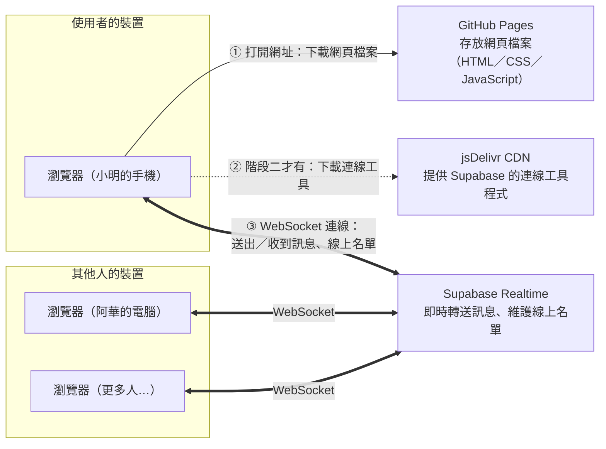
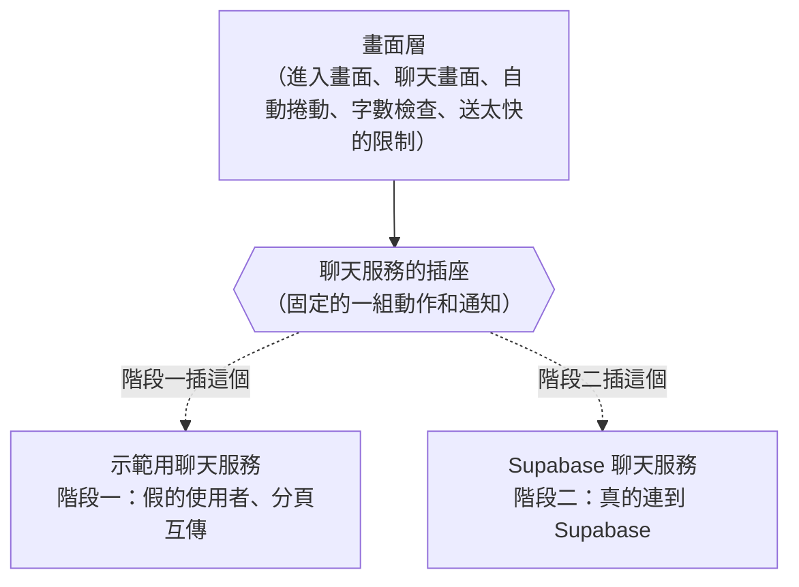

# 匿名聊天室：架構文件

> 這份文件是根據 `docs/requirements.md`，以及和需求方逐題問答確認的結果寫成的。
> 寫給不寫程式的人看：專有名詞第一次出現時，會在旁邊用一句話解釋。

---

## 1. 專案說明與目標

### 這是什麼

一個**不用註冊、不用登入**的網頁聊天室。全世界只有一個聊天室，任何知道網址的人打開網頁、取一個代號，就可以進來聊天。電腦和手機都能用。

### 目標

1. 打開網址、輸入代號、按「進入」，三步就能開始聊天。
2. 訊息即時出現在所有在線上的人的畫面上，不用重新整理。
3. 看得到現在誰在線上。
4. 不用花錢：網頁放在 GitHub Pages，即時傳訊用 Supabase 的免費方案。
5. 分兩個階段完成：先做出能操作的網頁，最後才接上 Supabase，而且接上時**不用重寫畫面的程式**。

### 問答確認過的行為（摘要）

| 主題 | 決定 |
|---|---|
| 歷史訊息 | 進來只看得到自己進來之後的新訊息；訊息**不保存** |
| 代號 | 1～10 個字；前後的空白自動刪掉；不能只有空白；中文、英文、數字、表情符號都能用；**可以重複**，但畫面上要分得出是不同的人 |
| 訊息 | 1～500 字；空白訊息不能送出；電腦和手機都是按 Enter 送出、Shift+Enter 換行，也都有「送出」按鈕（手機鍵盤大多沒有 Shift，所以手機上實際上不能換行，這是接受的取捨） |
| 每則訊息顯示 | 代號、幾點幾分；自己的訊息和別人的分得出來；網址只顯示成一般文字，不能點 |
| 誰在線上 | 人數加上代號清單，自己標「（你）」；電腦上一直顯示在旁邊，手機上平常只顯示人數，點一下才展開 |
| 進出提示 | **這一版不做**（見第 10 節） |
| 自己斷線 | 頂端顯示「連線中斷，正在重新連線…」；可以繼續打字但不能送出；連回來之後顯示一行「你剛剛斷線了，期間的訊息沒有收到」 |
| 重新打開網頁 | 記住上次的代號並預先填好，按「進入」就好，也可以改 |
| 離開 | 有「離開」按鈕，按了回到輸入代號的畫面；關掉網頁也算離開；不做改名功能 |
| 自動捲動 | 在最下面時自動捲到新訊息；往上看舊訊息時畫面不動，改出現「有新訊息 ↓」按鈕；自己送出訊息時一律捲到最下面 |
| 只有你一個人 | 顯示「目前只有你在這裡，把網址分享給朋友吧」 |
| 送太快 | 每人每 10 秒最多 5 則；超過時暫時不能送出，顯示「你送太快了，請稍等幾秒」 |

---

## 2. 整體架構圖



**怎麼看這張圖：**

- **GitHub Pages**（GitHub 提供的免費網頁空間，放上去的檔案就會變成一個網址）只負責一件事：使用者打開網址時，把網頁檔案交給瀏覽器。之後聊天的過程完全不經過它。
- **Supabase**（一個雲端服務，提供資料庫、即時傳訊等功能，我們只用其中的即時傳訊）就像一個總機：每個人的瀏覽器都跟它保持一條連線，有人送出訊息，它就馬上轉給其他所有人。
- **WebSocket**（瀏覽器和伺服器之間一條不會掛斷的連線，雙方隨時都能主動傳東西給對方）讓訊息可以「推」到你的畫面上，你不用一直重新整理。
- **CDN**（放在世界各地、專門讓人下載程式檔案的服務）。jsDelivr 是一個免費的 CDN，我們從它下載 Supabase 官方提供的連線工具程式，自己的 repo 裡就不用放這個檔案。
- **沒有我們自己的伺服器。** 整個系統只有「放網頁的地方」和「轉送訊息的地方」，這兩個都是別人提供的免費服務。

---

## 3. 技術選擇

### 3.1 前端語言：HTML + CSS + JavaScript

**前端**（使用者在瀏覽器裡看到、操作的那一部分程式）一定要用這三種語言寫，因為瀏覽器只看得懂這三種：

- **HTML**：決定畫面上有哪些東西（標題、輸入框、按鈕）。
- **CSS**：決定那些東西長什麼樣子（顏色、大小、位置）。
- **JavaScript**：決定按下去之後會發生什麼事（送出訊息、更新線上名單）。

### 3.2 框架：不用框架，也不需要「建置」

- **選了什麼**：直接寫原生的 JavaScript，並用瀏覽器內建的「模組」功能，把程式拆成好幾個檔案。不使用 React、Vue 這類框架（別人寫好的一套工具，幫你用固定的方式組織大型網頁程式），也不使用 Vite 這類建置工具（把你寫的程式「翻譯、打包」成瀏覽器能直接跑的檔案）。
- **為什麼**：
  1. **畫面很少**：這個專案只有兩個畫面，框架的好處在大型網頁才顯得出來。
  2. **不用安裝任何東西**：不用框架就不需要 Node.js、npm 這些開發工具。repo 裡的檔案就是瀏覽器實際執行的檔案，看到什麼就是什麼。
  3. **部署最簡單**：GitHub Pages 直接把 repo 裡的檔案放上網，不需要額外設定一個「先打包再上傳」的流程。
  4. **好除錯**：出問題時，瀏覽器顯示的錯誤行數，就是 repo 檔案裡的行數。
- **代價**：如果以後功能變得很多（例如多個聊天室、私訊、個人設定），沒有框架會比較難管理，到時候可以再換。第 4 節的「插頭設計」會讓這種替換比較容易。

### 3.3 Supabase 用哪個功能：只用 Realtime 的 Broadcast 和 Presence

Supabase 有很多功能（資料庫、登入、檔案儲存、即時傳訊…），這個專案**只用 Realtime（Supabase 的即時傳訊服務）**底下的兩個功能：

| 功能 | 一句話解釋 | 拿來做什麼 | 為什麼選它 |
|---|---|---|---|
| **Broadcast（廣播）** | 把一則訊息即時轉送給同一個頻道裡的所有人，但不存起來 | 聊天訊息 | 問答時決定「訊息不保存、進來看不到之前的對話」，Broadcast 剛好就是「只轉送、不儲存」 |
| **Presence（在線狀態）** | 每個人宣告「我在這裡」，Supabase 自動維護一份大家都看得到的在線名單，有人斷線就自動拿掉 | 「誰在線上」清單和人數 | 不用自己寫「誰還在、誰走了」的判斷；連關掉網頁、手機沒電這種沒有說再見的離開，都能自動處理 |

**頻道**（channel，Realtime 裡的一個「房間」，只有加入同一個頻道的人才會收到彼此的訊息）：整個網站只用一個頻道，名字叫 `room:lobby`。

**刻意不用的 Supabase 功能：**

- **Database（資料庫）**：訊息不保存，所以不用建任何資料表。這也讓安全問題簡單很多，因為根本沒有資料可以被偷看或刪除。
- **Auth（登入功能）**：需求就是不要登入。
- **Storage（檔案儲存）**：不能傳圖片或檔案。

### 3.4 Supabase 連線工具：supabase-js，從 CDN 載入

- **選了什麼**：Supabase 官方的 JavaScript 工具程式 `@supabase/supabase-js`（版本 2），從 jsDelivr CDN 載入，網址會寫死一個確切的版本號碼（例如 `@supabase/supabase-js@2.x.y`，實作時填入當時的版本）。
- **為什麼**：WebSocket 連線、斷線後自動重連、Presence 名單同步，這些麻煩事它都處理好了。版本號碼寫死，是為了避免官方哪天更新之後，網站突然出現不一樣的行為。
- 階段一完全不載入這個工具，所以階段一的網頁連 Supabase 的存在都不知道。

### 3.5 其他小決定

| 項目 | 選擇 | 原因 |
|---|---|---|
| 記住上次的代號 | 存在瀏覽器的 **localStorage**（瀏覽器提供給每個網站的一個小小的儲存空間，資料只存在這台裝置的這個瀏覽器裡） | 代號不會傳到別的地方；換一台裝置或清除瀏覽資料就會忘記，這樣是合理的 |
| 每個人的身分 | 每次「進入」時，瀏覽器隨機產生一個很長的亂碼當作**身分編號**（`senderId`） | 代號可以重複，所以需要另一個東西來分辨「兩個小明」；畫面上的區分標記就是從這個編號算出來的 |
| 訊息時間 | 用**收到訊息那台裝置**的時間 | 每個人的手機時間可能不一樣準，用自己裝置的時間才不會出現「未來的訊息」 |
| 計算字數 | 一個看起來是「一個字」的東西就算一個字（例如 👨‍👩‍👧 算 1 個字） | 一般程式算表情符號會算成好幾個字，使用者會覺得莫名其妙 |

---

## 4. 兩個階段

### 4.1 核心設計：「插頭」與「插座」

為了讓階段一做好的畫面，到階段二可以原封不動地繼續用，程式分成兩層：



把它想成**電器插座**：畫面層是一台電器，只認得插座的形狀；「示範用聊天服務」和「Supabase 聊天服務」是兩種不同的電源，但插頭形狀一模一樣。從階段一換到階段二，只是把插頭換插到另一個電源，電器本身不用改。

**插座的形狀**（兩種聊天服務都必須提供的東西）：

| 種類 | 名稱 | 意思 |
|---|---|---|
| 動作 | `connect(我的身分編號, 代號)` | 進入聊天室 |
| 動作 | `send(訊息內容)` | 送出訊息，事後回報「成功」或「失敗」 |
| 動作 | `leave()` | 離開聊天室 |
| 通知 | `onMessage` | 「有一則別人的新訊息」 |
| 通知 | `onPresence` | 「線上名單變了，這是最新的名單」 |
| 通知 | `onStatus` | 「連線狀態變了」：`connecting`（連線中）／`online`（已連上）／`offline`（斷線） |

**放在畫面層、兩個階段共用的規則**：代號和訊息的檢查（長度、空白）、每 10 秒 5 則的限制、記住代號、自動捲動、斷線時不能送出。這些規則只寫一次，所以兩個階段的行為一定會一樣。

**要用哪一種聊天服務，由設定檔 `js/config.js` 決定：**

- 設定檔裡的 Supabase 網址和金鑰是**空的** → 自動使用示範模式（階段一就是這樣）。
- 設定檔**有填** → 使用 Supabase。
- 網址後面加上 `?demo`（例如 `https://…/anon-chat/?demo`）→ 不管設定檔有沒有填，都強制使用示範模式。階段二之後還是可以拿來測試畫面。

### 4.2 階段一：還沒接 Supabase

**目標：除了「真的跟別台裝置上的人聊天」以外，所有畫面和操作都能在 GitHub Pages 上試用。**

示範模式能做到：

1. **完整的操作流程**：輸入代號 → 進入 → 聊天 → 離開 → 回到輸入代號的畫面；重新整理後代號已經填好。
2. **頂端一直顯示「示範模式：還沒連上真正的聊天室」**，避免有人以為已經可以跟別人聊天。
3. **2～3 個假的使用者**：會出現在線上名單裡，每隔一段隨機的時間說一句預先寫好的話。其中刻意有一個跟別人**同名**，用來檢查同名的區分標記。偶爾會有假的使用者離開、再回來，讓線上名單有變化。
4. **同一台電腦開兩個分頁可以互相聊天**：用瀏覽器內建的 BroadcastChannel（同一個瀏覽器裡、同一個網站的分頁之間互相傳話的功能）。兩個分頁會出現在彼此的線上名單裡，送出的訊息另一個分頁也會收到，可以用來確認「自己的訊息」和「別人的訊息」的區別。
5. **「模擬斷線」開關**：只有示範模式才有，按下去假裝斷線，可以檢查斷線提示、不能送出、打好的字有沒有留著、連回來之後的那一行提示。
6. **所有規則都會執行**：代號 1～10 字、訊息 500 字、10 秒 5 則、自動捲動、「有新訊息 ↓」按鈕、只有你一個人時的提示（把假的使用者都關掉時會出現）。

**怎麼在 GitHub Pages 上看到效果**：照第 12 節設定好一次之後，每次把程式推上 GitHub 的 `main` 分支，等一兩分鐘，打開 `https://<你的 GitHub 帳號>.github.io/<repo 名稱>/` 就看得到最新的版本。用手機打開同一個網址，就能檢查手機版的畫面。

### 4.3 階段二：接上 Supabase

**會改變的：**

1. 新增 `js/chat/supabase-chat.js`：一個符合「插座形狀」的 Supabase 聊天服務，內部用 Broadcast 傳訊息、用 Presence 管線上名單。
2. 在 `js/config.js` 填入 Supabase 的網址和 publishable key（見第 8 節）。
3. 頂端的「示範模式」字樣和「模擬斷線」開關，因為已經不是示範模式，會自動不顯示。
4. 真的可以跟其他裝置上的人聊天了。

**不會改變的：** 畫面、所有規則、資料夾結構（只多一個檔案）、部署方式。

**Supabase 那邊要做的設定（只有一次）：**

1. 到 supabase.com 註冊並建立一個新專案（project）。
   - 地區選離台灣近的，例如 **Northeast Asia (Tokyo)**，訊息延遲比較短。
   - 建立時會要你設定一組**資料庫密碼**，請存進密碼管理工具。這個專案用不到它，但不要弄丟，也不要寫進任何檔案。
2. **不用建任何資料表。**
3. Realtime 預設就是開啟的。到 Realtime 的設定頁，確認允許公開頻道（public channel，不用登入就能加入的頻道）的選項是打開的（預設就是打開的）。這個專案沒有登入功能，只能使用公開頻道。
4. 到 Project Settings → API Keys，複製 **Project URL** 和 **publishable key**，填進 `js/config.js`。

---

## 5. 通訊約定

這一節規定「大家的瀏覽器之間要怎麼講話」。示範模式和 Supabase 模式**用的是完全一樣的格式**，畫面層才不用分辨現在是哪一種。

### 5.1 頻道

| 項目 | 值 |
|---|---|
| Supabase 頻道名稱 | `room:lobby` |
| 示範模式的分頁頻道名稱 | `anon-chat-demo`（BroadcastChannel 用的） |

### 5.2 事件一覽

| 種類 | 事件名稱 | 誰送出 | 什麼時候 |
|---|---|---|---|
| Broadcast | `message` | 送訊息的人 | 按下送出，並通過所有檢查之後 |
| Presence | （Presence 的 track 動作） | 每個進入聊天室的人 | 進入時，以及斷線重新連上之後 |
| Presence | （Presence 的 untrack 動作） | 按「離開」的人 | 按下「離開」時 |
| Presence | `sync`（Supabase 送來的） | Supabase | 名單有任何變化時，送來一份完整的最新名單 |

> Presence 其實也會送出 `join`（有人加入）和 `leave`（有人離開）兩種通知。這一版不做進出提示，所以只用 `sync` 送來的完整名單來更新畫面。

### 5.3 訊息的資料格式（`message` 事件）

```json
{
  "v": 1,
  "msgId": "6f1c2b8e-3d4a-4c1e-9b7a-2e5f8d0c1a93",
  "senderId": "b2e4a7c9-1f3d-4e6a-8c2b-7d9e0f1a2b3c",
  "name": "小明",
  "text": "大家好！\n今天天氣真好"
}
```

| 欄位 | 意思 | 規則 |
|---|---|---|
| `v` | 格式版本 | 目前固定是 `1`；以後如果改格式，舊版的網頁看到不認得的版本就會直接忽略 |
| `msgId` | 這則訊息的編號 | 隨機產生的亂碼，用來避免同一則訊息出現兩次 |
| `senderId` | 送訊息的人的身分編號 | 每次進入時隨機產生；用來分辨同名的人，以及判斷是不是自己的訊息 |
| `name` | 送訊息的人的代號 | 1～10 個字 |
| `text` | 訊息內容 | 1～500 個字，可以有換行 |

**刻意不放時間**：每個人收到時，用自己裝置的時間（見 3.5）。

### 5.4 線上名單的資料格式（Presence）

每個人用自己的 `senderId` 當作 Presence 的 key（名單上分辨每個人用的鑰匙），附上：

```json
{
  "name": "小明",
  "joinedAt": "2026-10-13T08:30:00.000Z"
}
```

| 欄位 | 意思 |
|---|---|
| `name` | 代號 |
| `joinedAt` | 進入的時間，用來排序名單：自己永遠排第一，其他人照進來的先後排 |

### 5.5 收到東西時一律先檢查

任何人都可能故意送出格式不對的東西（見第 9 節），所以每個瀏覽器收到 `message` 或名單時，會先檢查一遍。**不符合上面規則的，直接丟掉，不顯示，也不跳錯誤。**

---

## 6. 資料流

### 6.1 進入聊天室

1. 使用者打開網址，瀏覽器從 GitHub Pages 下載網頁檔案。
2. 顯示「進入畫面」。如果 localStorage 裡有上次的代號，就預先填進輸入框。
3. 使用者輸入代號，按「進入」（或按 Enter）。
4. 檢查代號：刪掉前後的空白，以及看不見的特殊字元，然後檢查是否有 1～10 個字。不符合就在輸入框下方顯示原因，停在這個畫面。
5. 把代號存進 localStorage（下次預先填好用）。
6. 隨機產生這次的身分編號 `senderId`。
7. 切換到「聊天畫面」，頂端狀態顯示「連線中…」，送出按鈕先不能按。
8. 聊天服務開始連線：
   - Supabase 模式：建立 WebSocket 連線，加入 `room:lobby` 頻道，然後用 Presence 宣告「我在這裡」。
   - 示範模式：在短暫延遲後假裝連上，並送出假的使用者名單。
9. 連上之後，狀態變成 `online`，送出按鈕可以按了；收到第一份線上名單，顯示人數和清單。
10. 如果名單上只有自己，顯示「目前只有你在這裡，把網址分享給朋友吧」。
11. 其他人的畫面：線上名單和人數自動更新（沒有進出提示）。

### 6.2 送出訊息

1. 使用者按 Enter 或「送出」按鈕（Shift+Enter 是換行）。
2. 依序檢查，任何一項不通過就不送出，**打好的字都留在輸入框裡**：
   - 現在是斷線狀態 → 什麼都不做（按鈕本來就不能按）。
   - 刪掉前後的空白後是空的 → 什麼都不做。
   - 超過 500 字 → 送出按鈕不能按，並顯示「超過 500 字」。
   - 過去 10 秒內已經送了 5 則 → 顯示「你送太快了，請稍等幾秒」，等到可以送時，提示自動消失。
3. 通過檢查後，組成第 5.3 節格式的訊息，交給聊天服務送出。
4. **立刻**把這則訊息顯示在自己的畫面上，並清空輸入框，畫面捲到最下面。
5. 聊天服務（Supabase）把訊息轉給頻道裡的其他人。Supabase 預設不會把訊息轉回給送出的人，所以自己不會看到兩次。
6. 如果聊天服務回報送出失敗（例如剛好在這一瞬間斷線），在那則訊息旁邊標示「沒有送出」，讓使用者知道別人沒收到。
7. 其他人的瀏覽器收到訊息後：
   - 依第 5.5 節檢查格式，不對就丟掉。
   - 用自己裝置的時間標上「幾點幾分」，加到訊息清單最下面。
   - 如果本來就在最下面，自動捲到新訊息；如果正在往上看，畫面不動，出現「有新訊息 ↓」按鈕。

### 6.3 離開

**按「離開」按鈕：**

1. 聊天服務告訴 Supabase「我不在了」（Presence untrack），然後離開頻道、關閉連線。
2. 清空畫面上的訊息（之後重新進入時看不到之前的對話）。
3. 回到「進入畫面」，代號已經填好。
4. 其他人的線上名單會馬上少一個人。

**直接關掉網頁、手機沒電、把瀏覽器關掉：**

1. 來不及做任何事，連線就斷了。
2. Supabase 發現這條連線斷了，自動把這個人從 Presence 名單上拿掉，其他人的名單就會更新。這通常要幾秒到幾十秒，看斷線的方式而定。

### 6.4 斷線與重新連線

1. **發現斷線**：supabase-js 回報連線中斷，或瀏覽器回報網路斷了。聊天服務發出 `offline` 通知。
2. **畫面變化**：
   - 頂端顯示「連線中斷，正在重新連線…」。
   - 輸入框還能打字，但送出按鈕不能按，按 Enter 也不會送出。
3. **自動重連**：supabase-js 會自己一直嘗試重新連線，每次失敗後等久一點再試，使用者不用做任何事。
4. **其他人那邊**：如果斷線比較久，Supabase 會把這個人從名單上拿掉；等他連回來，又會出現在名單上。因為不做進出提示，其他人只會看到名單和人數變化。
5. **連回來之後**：
   - 重新加入頻道，重新用 Presence 宣告「我在這裡」（沿用同一個身分編號，所以同名的區分標記不會變）。
   - 頂端的斷線提示消失，送出按鈕恢復可以按。
   - 在聊天區插入一行「你剛剛斷線了，期間的訊息沒有收到」。
   - 斷線期間打的字還在輸入框裡。
6. **手機切到別的 App 再切回來**：手機常常會在背景把連線切掉，回來時就是上面的流程，會看到那一行斷線提示。

---

## 7. 畫面清單

> 這裡只說明「有什麼」和「會做什麼」。顏色、字體、大小、位置等視覺設計交給 /design。

### 7.1 進入畫面

| 元素 | 行為 |
|---|---|
| 聊天室名稱 | 固定文字 |
| 示範模式標示 | 只在示範模式出現：「示範模式：還沒連上真正的聊天室」 |
| 代號輸入框 | 如果有上次的代號就預先填好；最多 10 個字 |
| 「進入」按鈕 | 按了開始進入流程（6.1）；在輸入框按 Enter 效果一樣 |
| 錯誤說明 | 代號不符合規則時，在輸入框附近顯示原因，例如「請輸入代號」、「代號最多 10 個字」 |

### 7.2 聊天畫面

| 區塊 | 元素 | 行為 |
|---|---|---|
| 頂端 | 示範模式標示 | 只在示範模式出現 |
| 頂端 | 連線狀態提示 | 連線中顯示「連線中…」；斷線時顯示「連線中斷，正在重新連線…」；正常時不顯示 |
| 頂端 | 「離開」按鈕 | 按了執行離開流程（6.3） |
| 頂端 | 「模擬斷線」開關 | 只在示範模式出現 |
| 線上名單 | 人數 | 「線上 N 人」 |
| 線上名單 | 代號清單 | 自己排第一，標「（你）」；同名的人加上區分標記；其他人照進來的先後排 |
| 線上名單 | 手機上的行為 | 平常只顯示人數，點一下展開清單，再點一下收起來 |
| 訊息區 | 別人的訊息 | 代號（同名的加上區分標記）、內容（保留換行）、幾點幾分 |
| 訊息區 | 自己的訊息 | 跟別人的訊息分得出來；送出失敗時標示「沒有送出」 |
| 訊息區 | 系統訊息 | 目前只有一種：「你剛剛斷線了，期間的訊息沒有收到」；樣式跟一般訊息分得出來 |
| 訊息區 | 只有你一個人的提示 | 「目前只有你在這裡，把網址分享給朋友吧」；有別人進來或有訊息出現就消失 |
| 訊息區 | 「有新訊息 ↓」按鈕 | 往上捲時有新訊息才出現；點了捲到最下面並消失；自己捲到最下面也會消失 |
| 輸入區 | 輸入框 | 可以多行；Enter 送出，Shift+Enter 換行；斷線時仍可打字 |
| 輸入區 | 「送出」按鈕 | 斷線、空白、超過 500 字、送太快時不能按 |
| 輸入區 | 輸入提示 | 超過 500 字時顯示「超過 500 字」；送太快時顯示「你送太快了，請稍等幾秒」 |

### 7.3 共通行為

- 訊息區最多保留最近 500 則，更舊的會從畫面上移除，避免手機越用越慢。
- 網址、HTML 語法都當成一般文字顯示（見第 9 節）。
- 同名的區分標記是從 `senderId` 算出來的，同一個人在同一次進入期間不會變；離開再進入會拿到新的身分編號，標記也會變。

---

## 8. 金鑰

**金鑰**（key，一串很長的亂碼，用來證明「我有權限使用這個服務」，作用跟密碼很像）

### 8.1 這個專案會碰到的金鑰和密碼

| 名稱 | 長什麼樣子 | 用途 | 可以公開嗎 | 放在哪裡 |
|---|---|---|---|---|
| **Project URL** | `https://xxxx.supabase.co` | 告訴網頁要連到哪一個 Supabase 專案 | ✅ 可以 | `js/config.js`，會 commit 進 repo |
| **Publishable key**（舊版叫 anon key） | `sb_publishable_…` 開頭 | 讓網頁可以連上這個專案的 Realtime | ✅ 可以，而且**一定會公開** | `js/config.js`，會 commit 進 repo |
| **Secret key**（舊版叫 service_role key） | `sb_secret_…` 開頭 | 擁有專案的**所有權限**，可以繞過一切限制 | ❌ **絕對不能** | **哪裡都不放。這個專案用不到它，連複製都不要複製** |
| **資料庫密碼** | 建立專案時你自己設定的 | 直接連進資料庫 | ❌ **絕對不能** | 只存在你的密碼管理工具 |
| **Supabase／GitHub 帳號密碼** | — | 登入後台 | ❌ **絕對不能** | 只存在你的密碼管理工具，建議兩個都開啟兩步驟驗證 |

### 8.2 為什麼 publishable key 可以公開？

這是最容易讓人緊張的地方，所以詳細說明：

1. **它本來就藏不住。** 網頁是在每個使用者的瀏覽器裡執行的，網頁要連上 Supabase，就得把這把金鑰交給瀏覽器。任何人按 F12 打開開發者工具都看得到它，不管有沒有放上 GitHub 都一樣。
2. **它本來就是設計來公開的。** Supabase 把它命名為 publishable（可公開的），意思就是「放在網頁裡給大家用」。它能做什麼，取決於 Supabase 那邊允許什麼。
3. **在這個專案裡，它能做的事很少。** 我們沒有建任何資料表，所以拿到這把金鑰的人沒有資料可以偷看或刪除。他頂多能加入 `room:lobby` 頻道送訊息，而這件事本來就是公開網頁開放給所有人做的。

**真正的風險是有人拿這把金鑰大量送訊息，把免費額度用完**（見第 9 節）。這不是把金鑰藏起來就能解決的，要靠 Supabase 的額度上限和使用量監控。

### 8.3 怎麼產生

- **Project URL 和 publishable key**：建立 Supabase 專案時自動產生，不用自己做任何事。到 Project Settings → API Keys 複製就好。
- **如果 publishable key 被濫用**：可以在同一個頁面建立一把新的 publishable key、停用舊的，再把新的填進 `js/config.js` 推上 GitHub。
- **Secret key**：Supabase 也會自動產生，但這個專案**不需要**。如果哪天不小心外流，立刻到同一個頁面把它刪掉或換新。

### 8.4 怎麼避免把不該公開的東西 commit 到 GitHub

**commit**（把目前檔案的狀態存成一個版本，之後推上 GitHub 就會公開）

1. **規則很簡單：這個專案沒有任何秘密需要放在 repo 裡。** 唯一需要的設定是 Project URL 和 publishable key，兩個都可以公開。所以沒有「放秘密的檔案」，也就不會有「不小心把秘密檔案 commit 上去」的問題。
2. **`.gitignore`**（一份清單，列在上面的檔案，git 會假裝沒看到，不會 commit 它們）預先列入 `.env`、`.env.*`、`*.local`、`secrets*` 這類常見的秘密檔案名稱，萬一哪天有人建立了這類檔案，也不會被 commit。
3. **在 GitHub repo 的設定裡開啟 Secret scanning 和 Push protection**（GitHub 的保護功能：偵測到推上來的內容裡有像是秘密金鑰的東西時，會擋下來或發出警告）。公開的 repo 可以免費使用。
4. **每次填 `js/config.js` 時，確認貼上的是 `sb_publishable_` 開頭的金鑰**，不是 `sb_secret_`。
5. **如果真的不小心把 secret key 推上去了**：光把檔案刪掉沒用，因為 git 的歷史紀錄裡還查得到。正確做法是**馬上到 Supabase 後台把那把金鑰作廢**，作廢之後，外流的那串亂碼就沒用了。

---

## 9. 安全與限制

### 9.1 前提：沒有辦法真正「擋住」壞人

網頁的程式碼是公開的，會寫程式的人可以完全不透過我們的網頁，自己寫一支程式拿 publishable key 連上頻道，送出任何東西。所以：

- **網頁上的檢查（字數、送太快）只擋得住一般使用者**，以及不小心的操作。
- **每個瀏覽器收到東西時，都要自己再檢查一次**，不能相信別人送來的任何內容。這一點才是真正保護使用者的地方。

### 9.2 別人可能送進來的奇怪東西，以及怎麼處理

| 奇怪的東西 | 可能造成的問題 | 怎麼處理 |
|---|---|---|
| 訊息裡夾帶 HTML 或程式碼，例如 `` | **XSS 攻擊**（壞人把程式碼偽裝成訊息送進來，讓它在別人的瀏覽器裡執行，可能偷資料或亂改畫面） | 所有別人送來的文字，一律當成「純文字」放進畫面，**絕不當成 HTML 解讀**。所以 `<b>` 會原樣顯示成 `<b>` 三個字，不會變粗體 |
| 超長的訊息（例如一百萬字） | 畫面卡死 | 收到時檢查，超過 500 字直接丟掉 |
| 格式不對（少了欄位、欄位不是文字、`v` 不是 1） | 程式出錯 | 依第 5.5 節直接丟掉 |
| 超長的代號，或空白代號 | 名單版面被撐爆 | 收到時檢查，不符合 1～10 字的訊息丟掉；名單上的也不顯示 |
| 只有「看不見的字元」的代號或訊息（例如零寬空格） | 看起來像沒有名字、空白訊息 | 檢查空白時，連這些看不見的字元也算空白 |
| 會讓文字方向顛倒的特殊字元 | 畫面上的文字被弄亂 | 送出和顯示前移除這類控制字元 |
| 網址 | 騙人點進釣魚網站 | 網址只顯示成一般文字，不能點（問答決定） |
| 冒充別人：用一樣的代號 | 讓人以為是同一個人在講話 | 同名會有區分標記（問答決定） |
| 冒充別人：連身分編號都假造 | 區分標記也一樣，完全分不出來 | **這一版擋不住**，因為沒有登入就沒辦法證明「你是你」。見第 10 節 |
| 一秒送幾百則訊息洗版 | 畫面被洗掉、額度被吃光 | 每個瀏覽器收到時，同一個身分編號 10 秒內超過 10 則（比正常上限 5 則寬鬆，避免誤擋）的訊息直接丟掉不顯示。但這擋不住對方換身分編號，額度也還是會被吃掉 |
| 一次開幾百條連線 | 塞滿免費方案的連線上限，別人連不進來 | **這一版擋不住**，只能靠監控發現。見 9.3 和第 10 節 |

### 9.3 免費方案的上限

> 以下是寫這份文件時（2026 年 10 月）的大約數字，各服務可能會調整，**以官方頁面為準**：
> Supabase：<https://supabase.com/pricing>、<https://supabase.com/docs/guides/realtime/limits>
> GitHub Pages：<https://docs.github.com/pages/getting-started-with-github-pages/github-pages-limits>

**Supabase（免費方案）**

| 上限 | 大約數字 | 對這個專案的意思 |
|---|---|---|
| 同時在線的連線數 | 200 | 同時最多大約 200 人在聊天室裡（一個分頁算一條連線） |
| 每個月的 Realtime 訊息數 | 200 萬則 | **一則訊息被幾個人收到，就算幾則。** 例如 20 人在線時，有人送 1 則，就算約 20 則。20 人同時在線、每人每分鐘講 1 句的話，大約 6 小時就會用掉 1% |
| 每秒的訊息數 | 100 則 | 人很多又同時講話時，可能被暫時擋住 |
| 單則訊息大小 | 256 KB | 我們的訊息最多 500 字，遠遠用不到 |
| 專案暫停 | 一段時間沒有活動（官方目前寫 7 天）可能會被暫停 | 被暫停時聊天室會連不上，要登入 Supabase 後台手動恢復 |

**超過額度時**：免費方案不會自動收費，而是服務被限制或暫停。所以最壞的情況是「聊天室暫時不能用」，不會收到帳單。

**建議**：每週到 Supabase 後台的 Usage 頁面看一次使用量。

**GitHub Pages**

| 上限 | 大約數字 | 對這個專案的意思 |
|---|---|---|
| repo 必須公開 | 免費帳號的 GitHub Pages 只能用在公開的 repo | 所有程式碼和 `js/config.js` 都看得到，這在第 8 節已經說明過沒問題 |
| 網站大小 | 1 GB | 我們的網站只有幾十 KB |
| 每月流量 | 100 GB（建議值） | 網頁檔案很小，而且聊天訊息不經過 GitHub，不會用完 |

---

## 10. 這一版刻意不做的事

| 不做的事 | 為什麼 |
|---|---|
| 註冊、登入 | 需求就是不要登入 |
| 保存訊息、看歷史紀錄 | 問答決定：進來只看得到新訊息。不保存訊息也讓系統簡單很多，而且沒有資料外流的風險 |
| 有人進來或離開時的提示 | 問答時決定不做（**和 `requirements.md` 原本寫的不同**）。線上名單和人數還是會即時更新 |
| 改名 | 想換代號就先離開，再用新代號進入；這樣線上名單裡不會有名字突然變掉的狀況 |
| 手機上換行 | 手機鍵盤大多沒有 Shift 鍵，問答決定手機上按 Enter 也是送出 |
| 可以點的網址 | 避免被拿來騙人點進奇怪的網站 |
| 傳圖片、檔案、貼圖 | 需要儲存空間，也需要審核內容，超出這一版的範圍 |
| 多個聊天室、私訊 | 需求是「所有人在同一個聊天室」 |
| 編輯、收回訊息 | 訊息不保存，送出就已經到了別人的畫面上，收回沒辦法保證有效 |
| 已讀、「對方正在輸入…」 | 會大量增加訊息數量，吃掉免費額度 |
| 聲音、推播通知 | 需要額外取得使用者授權，這一版先保持單純 |
| 管理員、踢人、封鎖、髒話過濾 | 沒有登入就沒有辦法認出誰是管理員、也沒辦法真正封鎖一個人（他換個代號就回來了） |
| 伺服器端擋洗版、防冒充 | 要做到這些，需要讓每個人至少有一個「匿名身分」（Supabase 的匿名登入功能），再搭配 Realtime 的權限設定。這會增加不少複雜度。如果之後真的有人搗亂，這是第一個要加的功能 |
| 使用框架、建置工具 | 見 3.2：兩個畫面不需要，而且不想讓你安裝任何東西 |

---

## 11. repo 的資料夾結構

**repo**（repository，放這個專案所有檔案和修改紀錄的地方，放在 GitHub 上）

```
.
├── index.html              網頁的入口，兩個畫面都在這個檔案裡，用程式切換顯示哪一個
├── .nojekyll               空檔案，告訴 GitHub Pages「不要加工我的檔案，原樣放上去」
├── .gitignore              不要 commit 的檔案清單（見 8.4）
├── README.md               專案簡介、網址
├── css/
│   └── style.css           畫面的樣式（/design 和 /frontend-design 負責）
├── js/
│   ├── main.js             程式的起點：讀設定、決定用哪個聊天服務、啟動畫面
│   ├── config.js           Supabase 的網址和 publishable key（階段一是空的）
│   ├── core/               兩個階段共用的規則，跟畫面和連線都無關
│   │   ├── rules.js        代號、訊息的檢查（字數、空白、看不見的字元）
│   │   ├── rate-limit.js   10 秒 5 則的限制
│   │   ├── identity.js     產生身分編號、從編號算出同名的區分標記
│   │   └── storage.js      用 localStorage 記住上次的代號
│   ├── chat/               聊天服務（插座的兩種電源）
│   │   ├── demo-chat.js    示範模式：假的使用者、分頁互傳、模擬斷線
│   │   └── supabase-chat.js  階段二才新增：連到 Supabase
│   └── ui/                 畫面
│       ├── join-screen.js  進入畫面
│       ├── chat-screen.js  聊天畫面：訊息區、輸入區、自動捲動
│       ├── online-list.js  線上名單
│       └── person.js       頭像和「#三碼」標籤（訊息和名單共用）
└── docs/
    ├── requirements.md     需求說明
    ├── architecture.md     這份文件
    └── design.md           畫面設計規格（顏色、字體、元件）
```

**看懂這個結構的訣竅**：`core/` 是規則，`chat/` 是跟外界連線，`ui/` 是畫面。畫面只透過「插座」跟 `chat/` 講話，所以換掉 `chat/` 裡的檔案，畫面完全不用動。

---

## 12. 部署到 GitHub Pages 的方式

**部署**（把做好的網頁放到網路上，讓別人用網址就能打開）

選擇最簡單的方式：**直接從 `main` 分支的根目錄發布**，不用另外寫自動化流程。

### 第一次設定（只做一次）

1. 確認 repo 是**公開**（Public）的。
2. 到 GitHub 上的 repo → **Settings** → 左邊選 **Pages**。
3. **Source** 選 **Deploy from a branch**。
4. **Branch** 選 `main`，資料夾選 `/ (root)`，按 **Save**。
5. 等一兩分鐘，頁面上方會出現網址：`https://<你的 GitHub 帳號>.github.io/<repo 名稱>/`。
6. 順便到 **Settings** → **Code security** 開啟 Secret scanning 和 Push protection（見 8.4）。

### 之後每次更新

1. 把修改 commit 並推（push，把電腦上的版本上傳到 GitHub）到 `main` 分支。
2. GitHub 會自動重新發布，通常一兩分鐘內完成。可以在 repo 的 **Actions** 分頁看到進度，綠色勾勾代表完成。
3. 打開網址檢查。如果看到的還是舊版，按 Ctrl+Shift+R（Mac 是 Cmd+Shift+R）強制重新整理，或用手機的無痕模式打開。

### 注意事項

- 網址裡有 repo 名稱這一層（`/<repo 名稱>/`），所以程式裡引用檔案時，一律用**相對路徑**（例如 `js/main.js`，不寫成 `/js/main.js`），不然會找不到檔案。
- `docs/` 資料夾也會被放上網，例如 `…/docs/architecture.md` 打得開。repo 本來就是公開的，所以沒有影響。

---

## 13. 驗證清單

每一項都要在 **電腦（Chrome）** 和 **手機（iPhone Safari 或 Android Chrome 至少一種）** 上，用 **GitHub Pages 上的網址**測試，不是只在自己電腦上打開檔案測試。

### 階段一：示範模式

**部署**
- [ ] GitHub Pages 網址打得開，沒有空白頁，也沒有找不到檔案的錯誤
- [ ] 頂端顯示「示範模式：還沒連上真正的聊天室」

**進入畫面**
- [ ] 什麼都不打就按「進入」→ 不能進入，顯示原因
- [ ] 只打空白 → 不能進入
- [ ] 打 11 個字 → 不能進入（或輸入框不讓你打超過 10 個字）
- [ ] 打「　小明　」（前後有空白）→ 進入後代號顯示為「小明」
- [ ] 代號用中文、英文、數字、表情符號（例如「🐱貓貓」）都能進入；一個表情符號算 1 個字
- [ ] 在輸入框按 Enter 可以進入
- [ ] 進入後重新整理 → 輸入框已經填好上次的代號，可以修改

**聊天畫面**
- [ ] 進入後訊息區是空的（看不到之前的對話）
- [ ] 線上名單顯示人數、假的使用者、自己排第一並標「（你）」
- [ ] 有兩個同名的人時，畫面上分得出來
- [ ] 手機上名單平常只顯示人數，點一下展開、再點一下收起來
- [ ] 假的使用者會自動說話，訊息顯示代號和幾點幾分
- [ ] 假的使用者離開或回來時，名單和人數會更新，聊天區**沒有**出現進出提示
- [ ] 關掉所有假的使用者時，出現「目前只有你在這裡…」

**送出訊息**
- [ ] 電腦：Enter 送出、Shift+Enter 換行、「送出」按鈕也能送
- [ ] 手機：Enter 送出、「送出」按鈕也能送
- [ ] 送出後自己的訊息出現，而且跟別人的訊息分得出來，輸入框清空
- [ ] 多行訊息顯示時保留換行
- [ ] 只有空白不能送出
- [ ] 501 個字不能送出，顯示「超過 500 字」
- [ ] 10 秒內連送第 6 則 → 不能送出，顯示「你送太快了…」，打好的字還在；等幾秒後可以送
- [ ] 送出 `<b>粗體</b>` → 顯示成原本的文字，沒有變粗
- [ ] 送出 `https://example.com` → 顯示成一般文字，不能點

**自動捲動**
- [ ] 在最下面時，新訊息進來會自動捲過去
- [ ] 往上捲時，新訊息進來畫面不動，出現「有新訊息 ↓」；點了捲到最下面、按鈕消失
- [ ] 往上捲時自己送出訊息 → 捲到最下面

**分頁互傳**
- [ ] 同一台電腦開兩個分頁、用不同代號進入 → 彼此出現在線上名單裡
- [ ] A 分頁送的訊息，B 分頁收得到，而且在 B 分頁顯示成「別人的訊息」
- [ ] 兩個分頁用同一個代號 → 分得出來
- [ ] 關掉 A 分頁 → B 分頁的名單少一個人

**斷線（用「模擬斷線」開關）**
- [ ] 斷線時頂端顯示「連線中斷，正在重新連線…」
- [ ] 斷線時可以打字，但送出按鈕不能按，按 Enter 也不會送出
- [ ] 恢復連線後提示消失，聊天區出現「你剛剛斷線了，期間的訊息沒有收到」，打好的字還在

**離開**
- [ ] 按「離開」回到進入畫面，代號已經填好
- [ ] 再次進入時，看不到之前的訊息

### 階段二：接上 Supabase

**設定與金鑰**
- [ ] `js/config.js` 裡的金鑰是 `sb_publishable_` 開頭
- [ ] 用 GitHub 網頁搜尋整個 repo 的 `sb_secret`，找不到任何結果
- [ ] repo 已開啟 Secret scanning 和 Push protection
- [ ] 頂端**不再**顯示「示範模式」，也沒有「模擬斷線」開關
- [ ] 網址加上 `?demo` 時會回到示範模式

**真的跨裝置聊天**（找一台電腦和一支手機，或請朋友幫忙）
- [ ] 兩台裝置都進入 → 彼此出現在線上名單裡，人數正確
- [ ] 電腦送的訊息手機收得到，手機送的電腦收得到，延遲大約一秒以內
- [ ] 兩台裝置用同一個代號 → 分得出來
- [ ] 只有一台裝置在線時，出現「目前只有你在這裡…」
- [ ] 後進來的人看不到之前的訊息
- [ ] 階段一「進入畫面」、「送出訊息」、「自動捲動」的項目全部再測一次，結果一樣

**離開與斷線**
- [ ] 按「離開」→ 另一台裝置的名單幾秒內少一個人
- [ ] 直接關掉分頁 → 另一台裝置的名單在一分鐘內少一個人
- [ ] 手機開飛航模式 → 出現斷線提示、不能送出；關掉飛航模式 → 自動連回來，出現「你剛剛斷線了…」，名單恢復
- [ ] 手機切到別的 App 一分鐘再切回來 → 能自動連回來並繼續聊天
- [ ] 斷線期間另一台裝置送的訊息，連回來之後看不到（符合預期）

**安全**
- [ ] 打開瀏覽器的開發者工具，用 Console 直接送出一則 600 字的訊息 → 其他人的畫面上沒有出現
- [ ] 用 Console 送出 `` 當作訊息 → 其他人看到的是原本的文字，沒有跳出視窗

**額度**
- [ ] 測試完之後到 Supabase 後台的 Usage 頁面，確認看得到 Realtime 的連線數和訊息數
